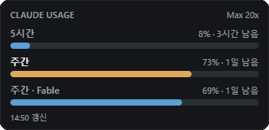
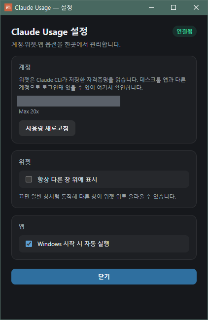

# Claude Usage Widget

Windows 바탕화면용 플로팅 위젯입니다. Claude의 **사용 한도**를 프로그레스바로 보여줍니다.
사용량은 Claude Code(CLI) 자격증명이나, 위젯 전용 브라우저 창으로 로그인한 **웹 세션**으로 읽습니다.

한도는 플랜에 따라 개수가 다릅니다. Max 계정이면 5시간 세션 · 주간 전체 · 모델별 주간이 각각 한 줄씩 나옵니다.



바 한 줄이 한도 하나입니다. 오른쪽에 사용률과 초기화까지 남은 시간이 붙습니다.

- **5시간** — 5시간 세션 한도
- **주간** — 주간 전체 한도
- **주간 · Fable** — 모델별 주간 한도. 모델 이름은 계정에 걸린 한도를 따라갑니다.

헤더 오른쪽은 플랜, 맨 아래는 마지막 갱신 시각입니다. 바 색은 70%부터 주황, 90%부터 빨강으로 바뀌고, 지금 소모 중인 한도는 라벨이 밝게 표시됩니다.

## 일반 사용자 (추천)

1. 프로젝트 폴더의 **`시작.bat`** 을 더블클릭하세요.
2. 처음 한 번만 릴리스 빌드·설치가 진행되고, 이후에는
   `%LOCALAPPDATA%\ClaudeUsageWidget\claude-usage-widget.exe` 가 바로 실행됩니다.
3. 바탕화면에 **Claude Usage Widget** 바로가기도 만들어 둡니다.
4. 위젯에서 **우클릭 → 설정** 으로 부팅 시 자동 실행을 켤 수 있습니다.

5. 같은 설정 창에서 **항상 다른 창 위에 표시** 를 끄면 일반 창처럼 동작해 다른 창이 위로 올라올 수 있습니다.

`target\debug\*.exe` 를 찾아 실행하면 **개발용**이라 화면이 비어 보이거나 안내 창만 뜹니다. 사용하지 마세요.

## 우클릭 메뉴와 설정 창

위젯 위에서 **우클릭**하면 **설정** 과 **종료** 두 항목이 나옵니다. 창이 트랙 수에 맞춰 줄어들어 항목이 늘면 메뉴가 잘리기 때문에, 나머지는 별도 설정 창으로 옮겼습니다.



- **계정** — **데이터 소스**(자동 / Claude Code / 웹 세션)를 고르고, 지금 읽고 있는 소스·계정 이메일·플랜을 보여줍니다 (위 이미지는 이메일을 가렸고, 웹 세션 카드가 생기기 전 화면입니다). **사용량 새로고침** 은 다음 폴링을 기다리지 않고 바로 다시 조회합니다.
- **웹 세션** — **브라우저로 로그인**, **연결 해제**, **로그인 프로필 초기화** 와 연결 상태(계정 · 저장 시각 · 만료 예상)가 있습니다. 아래 [웹 세션으로 연결](#웹-세션으로-연결)을 보세요.
- **위젯** — **항상 다른 창 위에 표시** 를 끄면 일반 창처럼 동작합니다.
- **앱** — **Windows 시작 시 자동 실행** 으로 부팅 시 자동 실행을 켜고 끕니다. 개발 모드에서는 바꿀 수 없어 비활성으로 표시됩니다.

오른쪽 위 배지는 연결 상태(연결됨 · 로그인 필요 · 갱신 실패)입니다. **닫기** 나 `Esc` 로 닫습니다.

## 트레이 아이콘

위젯은 작업 표시줄에 단추가 없는 대신 알림 영역(트레이)에 아이콘이 뜹니다.

- **왼쪽 클릭**: 위젯 보이기/숨기기
- **오른쪽 클릭**: `위젯 보이기` / `위젯 숨기기` / `설정` / `종료`

Windows 10은 새 트레이 아이콘을 `^` 숨김 영역에 넣습니다. 늘 보이게 하려면 아이콘을 작업 표시줄로 한 번 끌어 두세요.

## 어느 계정의 사용량인가

데이터 소스에 따라 다릅니다. **우클릭 → 설정** 의 계정 카드가 지금 읽고 있는 소스와 계정을 보여줍니다.

| 데이터 소스 | 읽는 곳 |
|------|------|
| 자동 (기본) | 웹 세션이 있으면 웹 세션, 없으면 Claude Code. 웹 세션이 로그인 필요로 끝나면 Claude Code로 한 번 더 시도합니다 |
| Claude Code | `~/.claude/.credentials.json` (CLI 로그인 계정) |
| 웹 세션 | 위젯 전용 브라우저 창에서 로그인한 claude.ai 계정 |

**두 소스의 계정이 다를 수 있습니다.** Claude Code 쪽 계정은 이렇게 확인합니다.

```bash
claude auth status
```

**Claude 데스크톱 앱의 로그인 계정과 다를 수 있습니다.** 데스크톱 앱은 자체 저장소(Chromium 세션)를 쓰고 위젯이 읽는 `~/.claude/.credentials.json` 과 별개입니다. 위젯에 다른 계정이 보이면 이렇게 맞추세요.

```bash
claude auth login
```

## 웹 세션으로 연결

Claude Code가 없거나 CLI 토큰(약 8시간)이 자주 만료될 때 씁니다.

1. **우클릭 → 설정 → 웹 세션 → 브라우저로 로그인** 을 누릅니다.
2. 위젯 전용 Chrome 창(없으면 Edge)이 claude.ai 로그인 화면으로 열립니다. **평소처럼 직접 로그인**하세요.
3. 채팅 화면이 보이면 **그 창을 직접 닫으세요.** 창이 닫히면 위젯이 화면 없이 같은 프로필을 잠깐 열어 쿠키만 읽고 저장합니다.

동작 방식과 제약:

- 로그인 창은 위젯 전용 프로필 `%LOCALAPPDATA%\ClaudeUsageWidget\login-profile\` 을 씁니다. 평소 Chrome 프로필은 읽지도 건드리지도 않습니다.
- 받은 쿠키(claude.ai 도메인만, Cloudflare 쿠키 제외)는 `%LOCALAPPDATA%\ClaudeUsageWidget\session.dat` 에 DPAPI(현재 Windows 사용자)로 암호화해 저장합니다. 다른 Windows 계정에서는 풀리지 않아 "로그인 필요"가 됩니다.
- 로그인 창은 자동화 연결 없이 띄웁니다. 디버깅 포트를 연 창에서는 claude.ai의 Cloudflare 체크가 끝없이 반복돼 로그인할 수 없었습니다(2026-10-12 실측). 그래서 로그인 완료를 창 닫힘으로 판단합니다. 10분 안에 닫지 않으면 중단합니다.
- `sessionKey` 는 약 28일 뒤 만료됩니다. claude.ai를 다시 열어도 만료가 늘지 않았습니다. 만료되면 **브라우저로 로그인** 을 다시 누르세요. 전용 프로필에 로그인이 남아 있으면 대개 창을 닫기만 하면 됩니다.
- API가 401/403이면 같은 프로필을 화면 없이 열어 쿠키를 한 번 다시 읽습니다(30분에 한 번 이하). 그래도 안 되면 "로그인 필요"를 표시합니다.
- **연결 해제** 는 `session.dat` 만 지웁니다. **로그인 프로필 초기화** 는 프로필 안에도 살아 있는 로그인까지 지웁니다.
- 예전 `scripts/spike_session.py`(평소 브라우저의 쿠키 DB를 직접 복호화)는 지웠습니다. 최신 Chrome의 app-bound(v20) 암호화와 실행 중 DB 잠금에 막혔고, 전용 프로필 방식이 둘 다 피합니다.
- 설계 배경: rag 저장소 `docs/assets/2026-10-12-widget-dedicated-profile-login-plan.md`

## 개발 실행

```powershell
npm install
npm run tauri dev
```

요구 사항: Windows + (Claude Code 로그인 또는 Chrome/Edge), Node.js, Rust, Visual Studio C++ Build Tools, WebView2.

## 스크립트

| 명령 | 용도 |
|------|------|
| `시작.bat` / `npm run start:app` | 설치본 실행 (비개발자) |
| `npm run rebuild:app` | release 강제 재빌드·재시작 (작업 완료 후) |
| `npm run build:app` | 릴리스 빌드만 |
| `npm run tauri dev` | Vite + debug (개발) |
| `npm run make:icon` | 아이콘 재생성 |
| `npm run spike` | usage API 스파이크 (Claude Code 토큰) |
| `npm run spike:web` | 웹 세션 스파이크 (전용 프로필 로그인 → Node·Rust 평문 HTTP 확인) |

## 동작 방식

```
# Claude Code 소스
~/.claude/.credentials.json  →  claudeAiOauth.accessToken
GET https://api.anthropic.com/api/oauth/usage      → limits[] (트랙)
GET https://api.anthropic.com/api/oauth/profile    → 계정·플랜

# 웹 세션 소스 (Cookie: claude.ai 쿠키, 일반 Chrome UA)
GET https://claude.ai/api/organizations             → 조직 선택(채팅 조직 중 lastActiveOrg 우선) · 플랜
GET https://claude.ai/api/organizations/{uuid}/usage → limits[] (트랙)
```

두 소스 모두 `limits[]` 를 줍니다. 없으면 `five_hour` 같은 기간별 창 중 값이 있는 것만 트랙으로 씁니다. 응답에 없는 한도를 0%로 만들지 않습니다.

5분마다 폴링합니다.

## 주의

- Claude Code 토큰은 **읽기만** 합니다. 갱신은 하지 않습니다 — Claude Code와 refresh token 회전이 겹치면 양쪽 로그인이 함께 풀릴 수 있습니다.
- Claude Code 소스의 accessToken은 수명이 8시간쯤입니다. 만료되면 위젯이 "Claude 로그인 필요"를 표시하고, Claude Code를 한 번 실행하면 다시 채워집니다. 웹 세션을 연결해 두면 자동 소스에서는 그동안에도 값이 표시됩니다.
- 두 소스의 엔드포인트 모두 **비공식**이며 언제든 깨질 수 있습니다. 값이 이상하면 공식 대시보드가 기준입니다.
- 토큰·쿠키 값은 로그·화면·커밋 어디에도 남기지 않습니다. 오류 문구에도 응답 본문을 넣지 않습니다.
